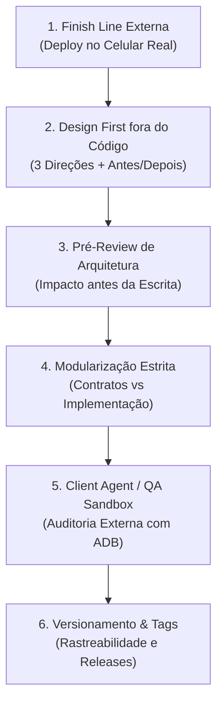

# Metodologia de Desenvolvimento Assistido por IA (Vibe Coding com Rigor)

> **Referência:** Práticas de engenharia inspiradas nas lições práticas de Lucas Montano aplicadas ao contexto do **Meu Ponto Android**.

---

## 1. O que é o "Vibe Coding com Rigor"?

Vibe coding sem método produz código que funciona no ambiente local em testes simples, mas falha em produção por problemas de concorrência, loops N+1, acoplamento destrutivo e falta de ergonomia real.

No **Meu Ponto Android**, o desenvolvimento com IA adota **6 pilares inegociáveis** para manter a qualidade de nível sênior, zero regressões e entrega contínua.

---

## 2. Os 6 Pilares da Metodologia

### Pilar 1: Finish Line Fora do Código (Deploy no Dispositivo Real)
- O agente nunca considera uma tarefa de UI/UX ou funcionalidade "concluída" apenas porque os testes unitários passaram.
- A linha de chegada definitiva é o **dispositivo físico do usuário** (Samsung Galaxy S25 Ultra):
  1. Build com `-PlocalTestSuffix=.localtest` para não tocar nos dados de produção do Jean.
  2. Instalação automatizada via ADB (`scripts/deploy_dogfood.sh`).
  3. Lançamento da Activity e confirmação visual na tela real.

### Pilar 2: Design First Fora do Código (Economia de Contexto e Tokens)
- **Nunca iterar design diretamente no código Jetpack Compose**: compilar e ajustar paddings/cores em Compose gasta tempo e inunda o contexto da IA com reescritas desnecessárias.
- **Protocolo de UI**:
  1. Antes de codar uma nova tela ou redesign, apresentar **3 direções visuais** (ex.: Compacta/Funcional, Imersiva/Espaçada, Material 3 Estrito).
  2. Apresentar o comparativo **Antes e Depois** com o fluxo visual.
  3. Validar a direção escolhida com Jean antes de tocar em um único arquivo `.kt`.
  4. Usar o vocabulário oficial do Android (Bottom Sheet, Scaffold, TopAppBar, Snackbar, Surface).

### Pilar 3: Pré-Review de Arquitetura (Contexto Antes da Decisão)
- Antes de qualquer refatoração estrutural, o agente deve mapear:
  - Como a estrutura funciona hoje.
  - Todos os arquivos afetados direta e indiretamente.
  - Como ficará a nova estrutura e por que ela é necessária.
- Mudar apenas o estritamente necessário para atender à regra ou correção.

### Pilar 4: Modularização Estrita & Regras de Fronteira
- **Domain (`domain/`)**: Contratos, modelos puros de negócio e cálculos de jornada/horas. **Zero dependência de Android SDK (`android.*`)** e zero I/O. 100% testável com JVM pura em milissegundos.
- **Data (`data/`)**: Implementação de persistência (Room), arquivos, OCR, importadores e exportadores.
- **UI (`ui/` e `MainActivity`)**: Apenas estado de exibição, eventos de entrada e composição declarativa. **Nunca faz I/O direto nem acessa o Room diretamente** (sempre via interfaces/ViewModel).
- **Enforcement Automatizado**: O script `scripts/check_architecture.py` valida essas fronteiras e falha o pipeline se houver import indevido.

### Pilar 5: Client Agent / QA Independente (Sandbox Externo)
- O mesmo desenvolvedor (ou agente) que escreveu o código tem viés de confirmação e não é um bom auditor exclusivo do próprio trabalho.
- O teste funcional deve ser conduzido por um agente/script externo (`scripts/client_agent_smoke_test.py`):
  - Executa ações pelo ADB simulando o usuário.
  - Registra pontos, altera datas, clica em filtros.
  - Tira screenshots reais do aparelho e registra evidências na pasta `docs/qa_evidence/`.

### Pilar 6: Versionamento Semântico e Tags Estritas
- Branches dedicadas para cada feature ou correção (`feat/...`, `fix/...`).
- Commits atômicos no padrão Conventional Commits.
- Tags explícitas (`vX.Y.Z`) que acionam a release automática pelo GitHub Actions.

---

## 3. Ferramentas Disponíveis no Repositório

| Ferramenta | Caminho | Finalidade |
|---|---|---|
| **Linter de Arquitetura** | `scripts/check_architecture.py` | Audita imports proibidos entre pacotes Kotlin (Domain vs Data vs UI). |
| **Deploy Dogfooding** | `scripts/deploy_dogfood.sh` | Compila com `.localtest`, envia para o notebook e instala no S25 Ultra via ADB. |
| **Client Agent QA** | `scripts/client_agent_smoke_test.py` | Simula interação de usuário via ADB e captura screenshots de evidência. |
| **Template de Design** | `docs/templates/ui-direction-template.md` | Roteiro para aprovação prévia de 3 direções visuais e antes/depois. |
